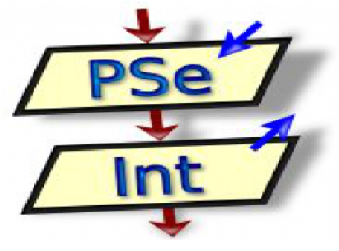

# Ejercicios Pseint del curso CePiT

---
### Estos son los ejercicios y pruebas con el programa Pseint del curso de Programacion Basica CePiT

|Tema|Dificultad|
|---|---|    
|variables|baja|  
|vectores|alta|  
|matrices|alta|  
|funciones|media|  

